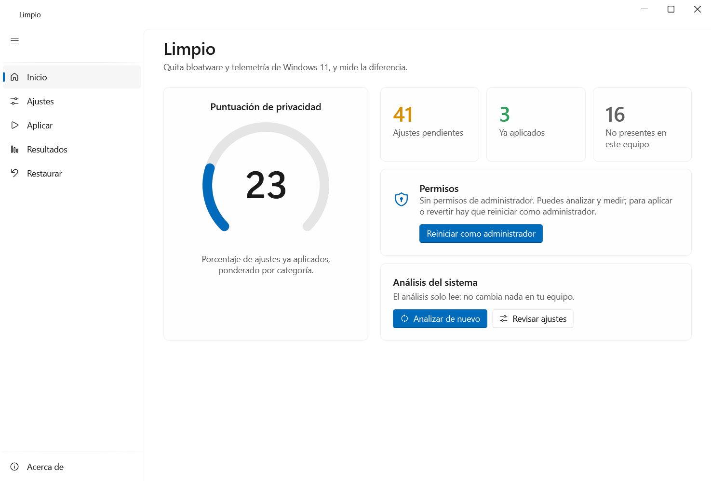
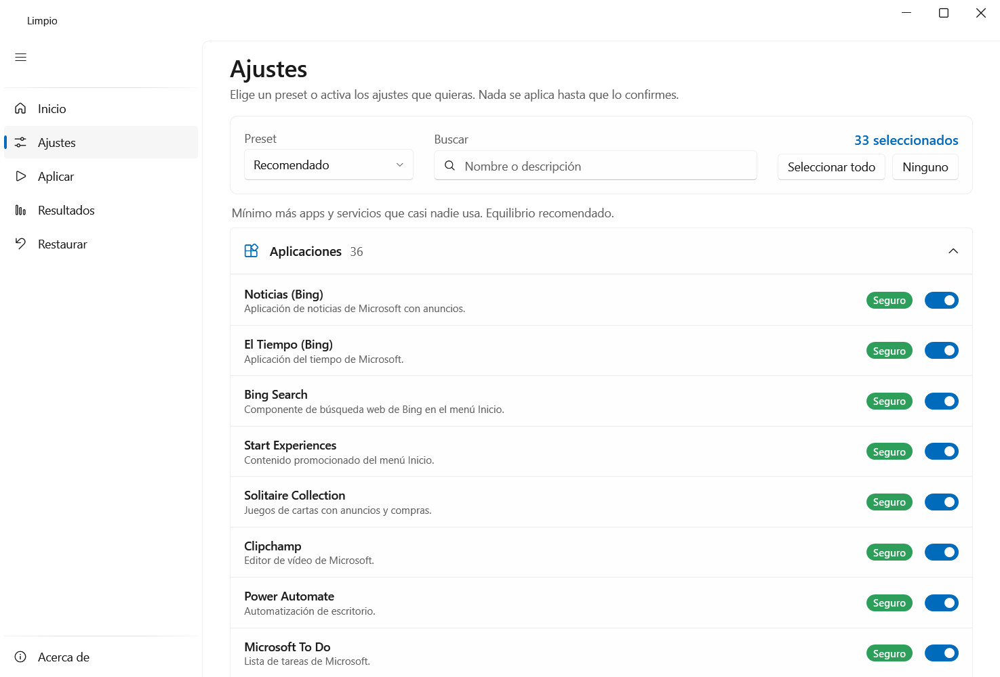
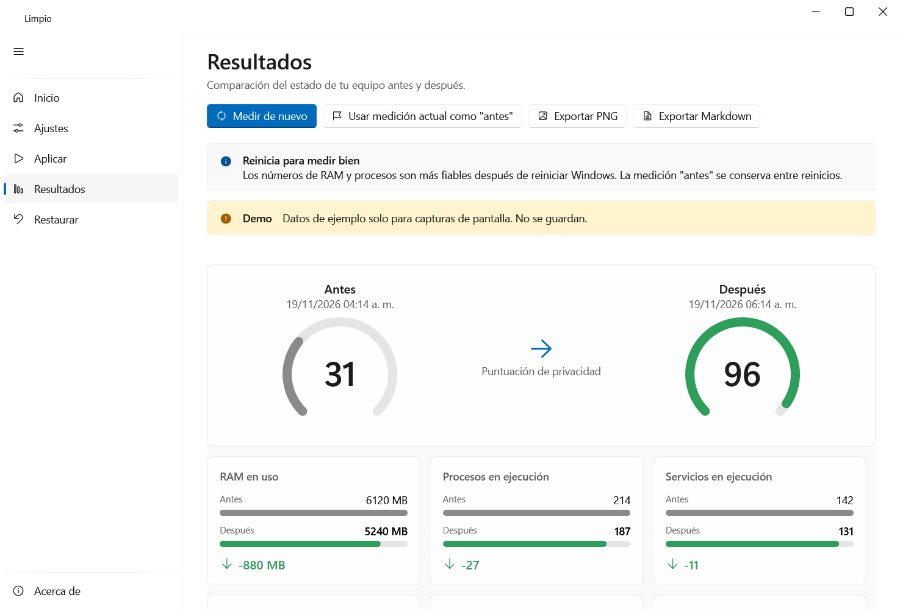

# Limpio

Limpia el bloatware y la telemetría de Windows 11, con copia de seguridad y una medición de antes y después.

[Español](#español) | [English](#english)



## Español

### Qué hace

- Analiza tu equipo sin cambiar nada (no necesita administrador).
- Quita apps preinstaladas (Bing, Clipchamp, Solitaire, Teams personal, Copilot, OneDrive opcional, trialware de fabricantes...).
- Reduce telemetría, publicidad y sugerencias; desactiva Recall y Copilot.
- Desactiva servicios y tareas programadas de recopilación de datos.
- Mide RAM, procesos, servicios, apps, tareas, programas de inicio y una puntuación de privacidad de 0 a 100, antes y después.
- Todo es un catálogo de datos (`tweaks.json`) que cualquiera puede ampliar. Ver [docs/tweaks.md](docs/tweaks.md).



### Descarga

Descarga `Limpio.exe` desde la página de [Releases](https://github.com/fsoftt/limpio/releases). Es un ejecutable único para Windows 11 x64 y no necesita instalar .NET.

### Presets

| Preset | Qué incluye |
|---|---|
| Mínimo | Lo más seguro: anuncios, ID de publicidad, telemetría básica, apps promocionales. |
| Recomendado (por defecto) | Mínimo más apps y servicios que casi nadie usa. |
| Agresivo | Todo el catálogo, incluidos Xbox, Game Bar, Phone Link, Widgets, OneDrive y ajustes avanzados. |
| Personalizado | Tu selección manual. Cambiar cualquier interruptor pasa a este modo. |

Cada ajuste muestra su riesgo (seguro, moderado, avanzado) y si ya está aplicado o no existe en tu equipo.

### Seguridad y copias

- Antes de aplicar se crea un punto de restauración del sistema (si está desactivado, verás un aviso) y un JSON con todos los valores originales en `%LOCALAPPDATA%\Limpio\backups`.
- Si un paso falla, el resto continúa y el fallo queda en el registro.
- Hay una lista protegida que el motor nunca toca aunque el catálogo lo pida: Microsoft Store, Edge, WebView2, winget, códecs de vídeo/imagen, Calculadora, Fotos, Paint, Bloc de notas, Terminal, Recortes, Seguridad de Windows, apps de drivers (Realtek, DTS, Intel), Windows Update (wuauserv, UsoSvc, BITS) y WinDefend.
- OneDrive se omite si Escritorio, Documentos o Imágenes están redirigidos dentro de OneDrive, y nunca se borra tu carpeta OneDrive.

### Cómo revertir

Abre la página **Restaurar**, elige una copia y pulsa Revertir (registro, servicios y tareas). Las apps eliminadas no se restauran solas: la página muestra un enlace para reinstalarlas desde Microsoft Store. OneDrive se reinstala desde <https://www.microsoft.com/microsoft-365/onedrive/download> o con `winget install Microsoft.OneDrive`. También puedes usar el punto de restauración de Windows.

### Antes y después

La página **Resultados** compara la primera medición ("antes", se conserva entre reinicios) con la última ("después"). Reinicia Windows antes de volver a medir: la RAM y los procesos son más fiables así. Puedes exportar la comparación como PNG o Markdown. La captura de ejemplo usa datos de muestra.



### Permisos

Analizar y medir funciona sin administrador. Para aplicar o revertir, el botón "Reiniciar como administrador" relanza la app con UAC y conserva tu selección.

### Compilar desde el código

Requiere el SDK de .NET 10.

```
dotnet build -c Release
dotnet test
dotnet run --project src/Limpio
```

Opciones de arranque para pruebas: `--page home|tweaks|apply|results|restore|about`, `--preset minimal|recommended|aggressive`, `--lang es|en`, `--demo` (datos de muestra en Resultados) y `--shot <archivo.png>` (guarda una captura de la ventana y sale; así se hicieron las de este README). Las pruebas usan adaptadores falsos y nunca modifican el sistema.

### Aviso

Limpio cambia ajustes del sistema. Úsalo bajo tu responsabilidad y revisa cada ajuste antes de aplicarlo. No está afiliado a Microsoft. Licencia MIT.

---

## English

### What it does

- Scans your PC without changing anything (no admin needed).
- Removes preinstalled apps (Bing, Clipchamp, Solitaire, personal Teams, Copilot, optional OneDrive, OEM trialware...).
- Cuts telemetry, ads and suggestions; turns off Recall and Copilot.
- Disables data-collection services and scheduled tasks.
- Measures RAM, processes, services, apps, tasks, startup entries and a 0 to 100 privacy score, before and after.
- Everything is a data catalog (`tweaks.json`) anyone can extend. See [docs/tweaks.md](docs/tweaks.md).

### Download

Get `Limpio.exe` from [Releases](https://github.com/fsoftt/limpio/releases). It is a single self-contained Windows 11 x64 executable; no .NET install needed.

### Presets

| Preset | Contents |
|---|---|
| Minimal | Safest only: ads, advertising ID, basic telemetry, promotional apps. |
| Recommended (default) | Minimal plus apps and services almost nobody uses. |
| Aggressive | The whole catalog, including Xbox, Game Bar, Phone Link, Widgets, OneDrive and advanced tweaks. |
| Custom | Your manual selection. Flipping any toggle switches to this mode. |

### Safety and backups

- Before applying, Limpio creates a System Restore point (a warning is shown if it is disabled) and writes a JSON file with every original value to `%LOCALAPPDATA%\Limpio\backups`.
- If a step fails, the rest continue and the failure is logged.
- A hard-coded protected list is never touched even if the catalog asks for it: Microsoft Store, Edge, WebView2, winget, video/image codecs, Calculator, Photos, Paint, Notepad, Terminal, Snipping, Windows Security, driver apps (Realtek, DTS, Intel), Windows Update (wuauserv, UsoSvc, BITS) and WinDefend.
- OneDrive is skipped when Desktop, Documents or Pictures are redirected into OneDrive, and your OneDrive folder is never deleted.

### How to revert

Open **Restore**, pick a backup and click Revert (registry, services, tasks). Removed apps are not restored automatically: the page links to the Microsoft Store to reinstall them. Reinstall OneDrive from <https://www.microsoft.com/microsoft-365/onedrive/download> or with `winget install Microsoft.OneDrive`. You can also use the Windows restore point.

### Before and after

**Results** compares the first measurement ("before", kept across reboots) with the latest ("after"). Reboot before measuring again for the most accurate RAM and process numbers. Export the comparison as PNG or Markdown. The sample screenshot uses demo data.

### Build from source

Requires the .NET 10 SDK.

```
dotnet build -c Release
dotnet test
dotnet run --project src/Limpio
```

Startup flags for testing: `--page`, `--preset`, `--lang`, `--demo` and `--shot <file.png>`. Tests use fake adapters and never touch the system.

### Disclaimer

Limpio changes system settings. Use it at your own risk and review each tweak first. Not affiliated with Microsoft. MIT license.
